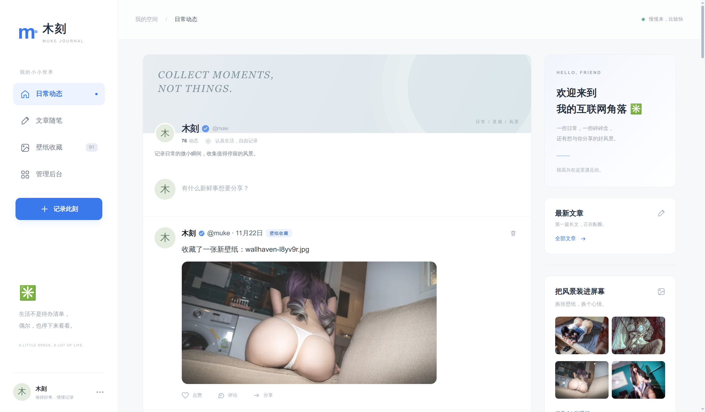

# 木刻 MUKE

当前版本：**0.1.0**。版本号以 [VERSION](VERSION) 为准，变更记录见 [CHANGELOG.md](CHANGELOG.md)。

PHP + SQLite 的个人动态 / 文章 / 壁纸收藏站。零框架、零构建：前端原生 HTML/CSS/JS，后端函数式 PHP，唯一第三方库是 [Parsedown](https://parsedown.org)（Markdown 渲染）。

支持两种发布形态：**动态部署**（自有服务器 / 内网，自带评论与点赞）与**静态部署**（一键导出纯 HTML 部署到 Netlify，评论接第三方系统）。



## 功能一览

- **动态时间线**：X 风格布局，短文字 + 最多 4 图，可编辑删除，服务端点赞计数
- **文章随笔**：Markdown / 富文本双模式、标签、草稿、独立详情页
- **壁纸瀑布流**：本地目录自动同步，筛选 / 搜索 / 4K 标记 / 原图下载，新壁纸自动发动态
- **评论**：匿名评论 + 审核 + 蜜罐限流 + 可选 Akismet 与邮件通知；静态站接 giscus / Waline / Twikoo
- **插件系统**：内容源可插拔（内置豆瓣、微博、壁纸三个参考实现），支持自定义卡片 / 页面 / 事件订阅
- **静态导出 + 一键部署**：无 JS 可读的纯静态站，Netlify 摘要式增量上传

## 快速开始

依赖：PHP 8.1+（pdo_sqlite / sqlite3 / mbstring / curl / fileinfo / zip）、ImageMagick。

从 [GitHub Releases](https://github.com/xxyangyoulin/muke/releases) 下载 `muke-<版本>.zip` 和 `SHA256SUMS`，运行 `sha256sum -c SHA256SUMS` 校验，解压后进入 `muke-<版本>/`。这是可运行的项目安装包，不是静态站点包，也不包含 PHP、ImageMagick、用户数据或个人配置。不要用它覆盖自己的 `var/` 和 `config.php`。

```sh
# 1. 环境自检
php bin/check.php

# 2. 启动（PM2）
pm2 start ecosystem.config.cjs && pm2 save
# 或裸 PHP：
php -S 127.0.0.1:8765 -d upload_max_filesize=16M -d post_max_size=68M -t public public/index.php

# 3. 打开后台建号（默认仅允许本机来源）
#    http://127.0.0.1:8765/admin
```

Docker：`docker compose up -d`（挂载 `var/` 与壁纸目录）。

生产环境使用 PHP-FPM 配合 Nginx/Apache，将文档根指向 `public/`，不存在的路由转发给 `public/index.php`；PHP 内置服务器用于本地运行。Docker 首次建号可通过 SSH 转发或临时设置精确的 `MKBLOG_SETUP_HOSTS` 来源地址，建号后撤销放行；不要长期设置为 `*`。

## 版本与项目安装包发布

采用 `major.minor.patch` 版本号。先修改 `VERSION` 和 `CHANGELOG.md`，提交本次发布所需的全部代码，再推送对应标签：

```sh
git tag v0.1.0
git push origin v0.1.0
```

标签必须与该提交的 `VERSION` 一致。GitHub Actions 会先运行完整测试，再生成项目安装 ZIP 和 `SHA256SUMS`，上传至对应 GitHub Release；不执行静态站点导出。使用仓库自带的 `GITHUB_TOKEN`，不需要配置个人令牌；仓库须允许 GitHub Actions 运行及工作流申请 `contents: write` 权限。

本地可执行 `bash scripts/package.sh v0.1.0`（仅在 Git 源码仓库中使用），产物在 `build/release/`。打包只读取 **HEAD 中已提交的文件**，不包含尚未提交的修改；私有配置、数据库、上传图片、壁纸原图、缓存和 `dist/` 均不打包。新的版本请创建新的标签，不移动已发布标签；更新版本号时同步更新本页版本与命令示例。

升级前先做完整备份。将新版本解压至新目录，接回自己的配置与数据目录，运行环境自检后再切换服务；数据库迁移会在首次启动执行，回退旧代码可能还需要恢复升级前的数据备份。

## 配置

两层：**后台「站点设置」界面修改即生效**（运行参数：标语、壁纸目录、限额、评论、缩略图等），`config.php`（个人覆盖，不入库不入 Git）承载基础设施项。完整默认值见 `config.default.php`，常用环境变量：

| 环境变量 | 说明 |
| --- | --- |
| `MKBLOG_DATA_DIR` | 数据目录（SQLite、上传、缓存），默认 `var/` |
| `MKBLOG_WALLPAPER_DIR` | 壁纸源目录（后台亦可改） |
| `MKBLOG_SITE_URL` | 对外地址，canonical / RSS / 邮件引用（如 `https://eyee.top`） |
| `MKBLOG_SETUP_HOSTS` | 允许首次建号的来源 IP（默认仅本机，`*` 为任意） |
| `MKBLOG_HTTP_PROXY` | 出站请求代理（部署 / 拉取远程内容） |

## 发布内容

- **动态 / 文章**：后台直接发布；文章详情页每篇一个 URL，可被收录
- **壁纸**：把图片放进壁纸目录即可，自动登记；管理后台可删除
- **静态站**：后台「静态发布」→ 生成 / 下载 zip / 一键部署 Netlify（首次填令牌 + 站点 ID）；可选「发布新动态后自动部署」（默认关，防抖 10 分钟，新动态顺延计时）。静态站无任何管理入口，账号密码数据库等全留在本地

内容更新流程：本地发布 → 重新导出部署（一键部署会自动先导出）。

## 插件

`plugins/` 目录下的插件提供内容源与页面，后台「动态插件」页签管理（开关 / 配置 / 同步 / 清空 / 移除）。内置豆瓣、微博（RSSHub）、壁纸三个参考实现，分别演示内容同步、自定义卡片、整页路由、数据端点、上传、图片服务与静态导出。壁纸专属默认配置与环境变量声明位于其 `plugin.php`。

开发自己的插件见 **[docs/plugins.md](docs/plugins.md)**，架构与数据流见 **[ARCHITECTURE.md](ARCHITECTURE.md)**。

删除语义：手动删除插件同步的动态会留墓碑（不再同步回来）；壁纸源文件删除则清动态、文件回归可重发。

## 备份与安全

- 核心数据在 `var/`，壁纸原图可以位于外部目录。完整备份：`php bin/backup.php /absolute/path/backup.zip`，包含数据库快照、上传图片、头像/封面和插件声明的资源目录。
- 恢复到已创建的空目录：`php bin/restore.php backup.zip /absolute/path/restored-data`，再将 `MKBLOG_DATA_DIR` 指向该目录。恢复会重定位插件资源目录；不会覆盖当前数据。代码、`config.php`、环境变量与部署凭据需另外保管。备份期间暂停外部程序改写资源文件。
- 后台 JSON 导入/导出是内容备份（含评论与上传图片），不包含账号、壁纸原图及插件业务表，不能代替完整备份。
- 可手动执行 `php tests/restore-rehearsal.php /absolute/path/empty-directory` 演练：只读快照现有数据库，在隔离副本上完成备份、恢复、逐表及文件哈希校验和迁移。需预留资源总量约三倍的空间，暂停外部资源写入；结束后自动清理生成的副本与压缩包，不启动同步、部署或邮件任务，也不替代真实登录验证。
- 安全机制：CSRF 全覆盖、登录限速（5 次失败锁 15 分钟）、评论蜜罐 + 频控、Markdown 原始 HTML 转义、出站请求 SSRF 防护、上传 MIME 白名单

## 许可

MIT，见 [LICENSE](LICENSE)。
